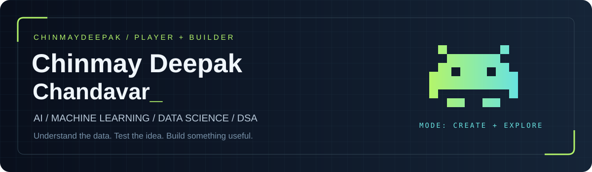
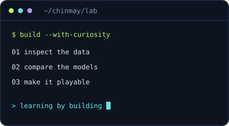
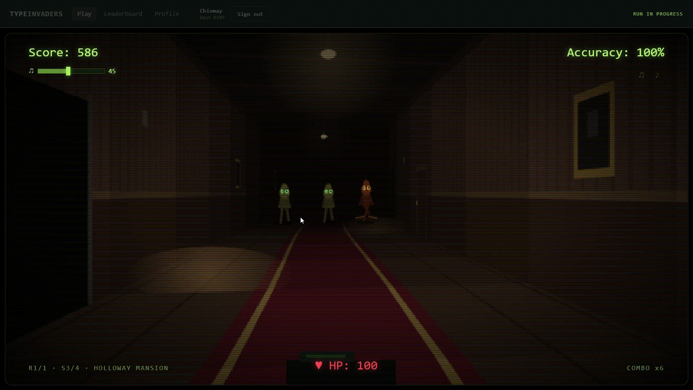

<a href="#about-me">ABOUT</a> &nbsp; / &nbsp; <a href="#arcade">ARCADE</a> &nbsp; / &nbsp; <a href="#featured-projects">PROJECTS</a> &nbsp; / &nbsp; <a href="#toolkit">TOOLKIT</a> &nbsp; / &nbsp; <a href="https://github.com/ChinmayDeepak?tab=repositories">ALL REPOSITORIES ↗</a>

<h2>A curious mind. A practical build.</h2>

<table width="100%"><tr>
<td width="55%" valign="top"><h3>Hi, I'm Chinmay 👋</h3>
I work on <b>AI, machine learning, and data science</b>, and I'm strengthening my foundation in <b>data structures and algorithms</b>.

My projects span credit-risk models, hyperspectral anomaly detection, SQL analytics, and games. I enjoy turning an experiment into something people can explore.

<b>My approach:</b> inspect the data, compare against a baseline, and explain the tradeoffs.
</td>
<td width="45%" align="center" valign="middle"></td>
</tr></table>

<h2>👾 The arcade</h2>

<b>TYPE INVADERS</b> Type the words. Stop the invaders. Keep the streak alive.

<a href="https://github.com/ChinmayDeepak/Type-Invader">Web edition source</a> &nbsp; · &nbsp; <a href="https://github.com/ChinmayDeepak/Type-Invader-HTML">Standalone HTML edition</a> &nbsp; · &nbsp; <a href="assets/type-invaders-preview.png">Still preview</a> Preview recorded from the standalone edition. The web game opens on a separate page.

<table width="100%"><tr>
<td width="50%" valign="top"><h3>⚛️ Quantum Counter-Move</h3>
Rock-Paper-Scissors meets Grover's algorithm. Explore counter-moves, iteration counts, and simulated quantum noise through a Streamlit interface.

<code>Python</code> <code>Qiskit</code> <code>Streamlit</code>
<a href="https://github.com/ChinmayDeepak/quantum-counter-move-engine"><b>Explore the experiment →</b></a></td>
<td width="50%" valign="top"><h3>🪨 Lagori</h3>
A Roblox adaptation of the seven-stones game: knock down the stack, rebuild it with your team, and dodge the defenders' ball.

<code>Roblox Studio</code> <code>Luau</code> <code>Game systems</code>

<b>In development</b> · Multiplayer testing still to complete.
</td>
</tr></table>

<h2>🧠 From data to working models</h2>

Selected coursework and experiments across deep learning, classical ML, and algorithms.

<table width="100%">
<tr>
<td width="50%" valign="top"><h3>🛰️ <a href="https://github.com/ChinmayDeepak/HyperSpectral-Anomaly-Detection-MSnet-Xai-Adaptive-Lambda">Hyperspectral anomaly detection</a></h3>
Extending the official MSNet implementation with adaptive loss weighting, training diagnostics, and experimental XAI control signals.

PyTorch · Self-supervised learning · Streamlit
</td>
<td width="50%" valign="top"><h3>🏦 <a href="https://github.com/ChinmayDeepak/home-loan-data-analysis">Home loan prediction</a></h3>
Neural classification on 307,000+ applications. Comparing class weighting, undersampling, and SMOTE with metrics beyond accuracy.

TensorFlow · Keras · Imbalanced classification
</td>
</tr>
<tr>
<td width="50%" valign="top"><h3>👥 <a href="https://github.com/ChinmayDeepak/employee-turnover-analytics">Employee turnover analytics</a></h3>
Exploring turnover patterns, clustering employees, and comparing classifiers while examining data leakage and evaluation tradeoffs.

scikit-learn · K-means · Model evaluation
</td>
<td width="50%" valign="top"><h3>🎵 <a href="https://github.com/ChinmayDeepak/creating-cohorts-of-songs">Song cohorts</a></h3>
Finding groups of similar tracks using Spotify audio features, PCA, and K-means, with interpretable cohort descriptions.

pandas · PCA · Clustering
</td>
</tr>
<tr>
<td width="50%" valign="top"><h3>⚙️ <a href="https://github.com/ChinmayDeepak/priority-sheduling-heap">Heap-based CPU scheduling</a></h3>
An interactive scheduling simulator with a binary max-heap, Gantt charts, waiting times, and CPU utilization.

JavaScript · Heaps · Priority queues
</td>
<td width="50%" valign="top"><h3>🚗 <a href="https://github.com/ChinmayDeepak/mercedes-benz-greener-manufacturing">Greener manufacturing</a></h3>
Predicting vehicle test-bench time with XGBoost and testing how dimensionality reduction changes model performance.

XGBoost · Regression · Cross-validation
</td>
</tr>
</table>

<h2>🛠️ My toolkit</h2>
<h3>Languages & foundations</h3>

     

<h3>AI, machine learning & data</h3>

       

Also used: XGBoost · SciPy · Matplotlib · Seaborn · PCA · K-means · SMOTE · Integrated Gradients

<h3>Applications & experiments</h3>

       

<b>📂 More projects — analytics, databases & applications</b>

 
<ul>
<li><a href="https://github.com/ChinmayDeepak/lending-club-loan-data-analysis">Lending Club Loan Analysis</a> — feature transformation, credit-risk EDA, and neural classification.</li>
<li><a href="https://github.com/ChinmayDeepak/walmart-retail-analysis">Walmart Retail Analysis</a> — seasonality, sales statistics, and forecasting experiments.</li>
<li><a href="https://github.com/ChinmayDeepak/aal-sales-analysis">AAL Sales Analysis</a> — sales dashboards and business recommendations.</li>
<li><a href="https://github.com/ChinmayDeepak/air-cargo-analysis">Air Cargo Analysis</a> — MySQL schemas, procedures, and analytical queries.</li>
<li><a href="https://github.com/ChinmayDeepak/scienceqtech-employee-performance">ScienceQtech Employee Performance</a> — SQL reporting and window functions.</li>
<li><a href="https://github.com/ChinmayDeepak/relayrx">RelayRx</a> — refill-coordination prototype with Gemini copilots and synthetic demo data.</li>
<li><a href="https://github.com/ChinmayDeepak/weather-app-python">Weather App</a> — Python, Tkinter, and API integration.</li>
<li><a href="https://github.com/ChinmayDeepak/patterns-practice">Python Pattern Practice</a> — loops, strings, conditions, and problem-solving fundamentals.</li>
</ul>

 <b>Thanks for stopping by.</b> Explore a project, read an experiment, or take an arcade break.  <a href="https://github.com/ChinmayDeepak?tab=repositories">Explore all repositories ↗</a>

